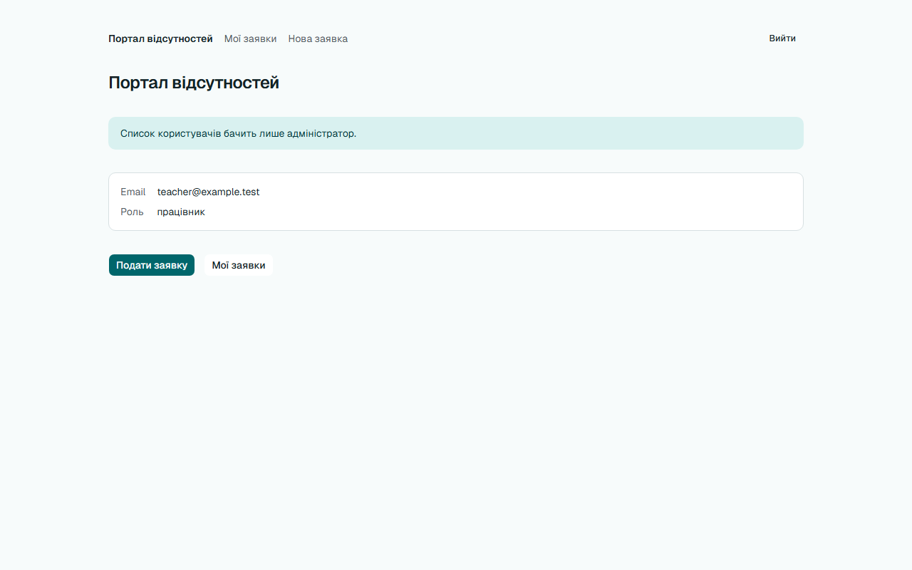

# Звіт UAT — 26.10.2026

- **Застосунок:** https://quitcode-ws6-leave-portal-demo.vercel.app
- **Код тестів:** `ws8/e2e-uat` @ `daf6190`
- **Прогін:** 26.10.26, 19:42 (Київ), Playwright 17.8 с; AC: 0 — PASS 0, FAIL 0, NEEDS-HUMAN 0; негативних контролів: 2
- **Рецензент:** `claude-haiku-5-5`; суперечки → `claude-sonnet-5-5`. Разом за розбір: $0.0373 (ціни API; за підпискою — у межах ліміту плану)
- **Прибирання:** синтетичних uat-*@example.test видалено 0, лишилось 0, заявок, що лишились: 0
- **Відео й траси:** не в git — `test-results/` локально або артефакт CI; трасу відкриває `npx playwright show-trace <trace.zip>`

| AC | Перевірки | Агент | Підсумок | Чому | Playwright | Розбір |
|---|---|---|---|---|---|---|
| NC-1 (AC-USERS-07) | впали | Haiku: PASS | **FAIL** | R1: перевірка впала — FAIL завжди, агент не перекриває | 7.0 с | $0.0019, 8.2 с |
| NC-2 (AC-USERS-07) | пройшли | Haiku: NEEDS-HUMAN, Sonnet: FAIL | **NEEDS-HUMAN** | R3: перевірки пройшли, агент не погоджується — вирішує людина | 2.5 с | $0.0354, 25.1 с |

## NC-1 — негативний контроль для AC-USERS-07 — FAIL

**Тест:** NC-1 (AC-USERS-07, навмисно хибне очікування в тесті: інший текст повідомлення)

**Критерій** (requirements/01-user-invites.md):

> AC-USERS-07: Дано працівник teacher@example.test увійшов у портал. Коли він відкриває сторінку списку користувачів за її адресою. Тоді він потрапляє на головну сторінку й бачить повідомлення «Список користувачів бачить лише адміністратор.», а жодного email, ролі чи посади інших користувачів не бачить.



**Кроки:** ✔ Дано: працівник teacher@example.test увійшов у портал → ✔ Коли: він відкриває сторінку списку користувачів за її адресою → ✘ Тоді: він потрапляє на головну сторінку й бачить повідомлення «Список користувачів бачить лише адміністратор.», а жодного email, ролі чи посади інших користувачів не бачить

**Перевірка впала:**

```
Error: expect(locator).toHaveText(expected) failed

Locator:  getByRole('status')
Expected: "Список користувачів доступний лише адміністраторам."
Received: "Список користувачів бачить лише адміністратор."
Timeout:  5000ms

Call log:
```

**Агент (claude-haiku-5-5, PASS):** На кадрі видно головну сторінку з заголовком «Портал відсутностей» і блоком повідомлення, текст якого дослівно збігається з критерієм, включно з крапкою. Список інших користувачів на кадрі не показаний; видно лише картку з email teacher@example.test і роллю «працівник», тобто власні дані працівника. URL на кадрі не видно, тож «сторінка /» з ac.md не перевірено самим кадром.

**Цитати агента, звірені зі сторінкою (aria):**
- «Список користувачів бачить лише адміністратор.» — є на сторінці

**Правило:** R1: перевірка впала — FAIL завжди, агент не перекриває

**Відео:** `test-results/artifacts/negative-controls-NC-1-AC--2583a-і-інший-текст-повідомлення--negative-controls/video.webm` · **траса:** `test-results/artifacts/negative-controls-NC-1-AC--2583a-і-інший-текст-повідомлення--negative-controls/trace.zip` (не в git)

_Негативний контроль: навмисно хибне очікування. Очікуваний підсумок — FAIL або NEEDS-HUMAN, не PASS._

## NC-2 — негативний контроль для AC-USERS-07 — NEEDS-HUMAN

**Тест:** NC-2 (AC-USERS-07, PM уточнив текст «Тоді», тест і застосунок — ні)

**Критерій** (анотація ac-text у тесті (негативний контроль)):

> AC-USERS-07: Дано працівник teacher@example.test увійшов у портал. Коли він відкриває сторінку списку користувачів за її адресою. Тоді він потрапляє на головну сторінку й бачить повідомлення «Список користувачів доступний лише адміністраторам.», а жодного email, ролі чи посади інших користувачів не бачить.


**Кроки:** ✔ Дано: працівник teacher@example.test увійшов у портал → ✔ Коли: він відкриває сторінку списку користувачів за її адресою → ✔ Тоді: він потрапляє на головну сторінку й бачить повідомлення «Список користувачів бачить лише адміністратор.», а жодного email, ролі чи посади інших користувачів не бачить

**Агент (claude-sonnet-5-5, FAIL):** Кадр показує головну сторінку «Портал відсутностей» з банером «Список користувачів бачить лише адміністратор.» та лише власним email і роллю (teacher@example.test, працівник). Редирект і відсутність чужих даних видно, але текст повідомлення посимвольно не збігається з критерієм PM.

Haiku сказав NEEDS-HUMAN, тож розбір повторив Sonnet; рішення агента — за Sonnet.

**Агент бачить вади:**
- Текст повідомлення на кадрі «Список користувачів бачить лише адміністратор.» не збігається з критерієм PM «Список користувачів доступний лише адміністраторам.» (інші слова: «бачить» замість «доступний», «адміністратор» замість «адміністраторам»).
- У ac.md перелік видимих частин містить формулювання, що відрізняється від дослівного критерію PM; воно збігається з кадром, але не з критерієм.

**Правило:** R3: перевірки пройшли, агент не погоджується — вирішує людина

**Відео:** `test-results/artifacts/negative-controls-NC-2-AC--f09d1-ді»-тест-і-застосунок-—-ні--negative-controls/video.webm` · **траса:** `test-results/artifacts/negative-controls-NC-2-AC--f09d1-ді»-тест-і-застосунок-—-ні--negative-controls/trace.zip` (не в git)

_Негативний контроль: навмисно хибне очікування. Очікуваний підсумок — FAIL або NEEDS-HUMAN, не PASS._

## Як читати підсумок

- **PASS** — автоматичні перевірки пройшли, агент-рецензент погодився з кадром, а кожну його цитату знайдено на сторінці.
- **FAIL** — впала автоматична перевірка. Агент цього не перекриває: невидимі вади (буфер обміну, база) він на кадрі не побачить.
- **NEEDS-HUMAN** — перевірки зелені, але агент не погодився або його цитати немає на сторінці. Часто це слабкий тест або розбіжність між текстом AC і тестом — питання до PM, а не обов'язково вада продукту.

Правила: R1: перевірка впала — FAIL завжди, агент не перекриває; R2: немає вердикту агента або кадру; R3: перевірки пройшли, агент не погоджується — вирішує людина; R4: цитати агента немає на сторінці (aria) — не підтверджено; R5: помилка сторінки або 5xx під час сценарію; R6: перевірки, агент і цитати збігаються.
