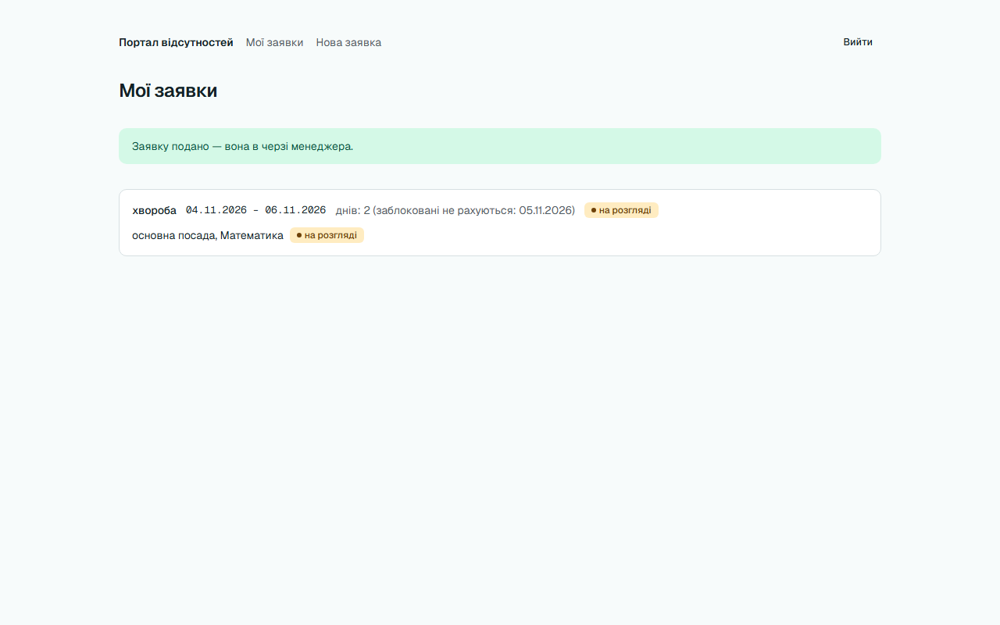
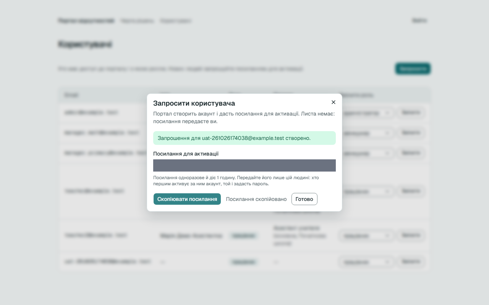

# Звіт UAT — 26.10.2026

- **Застосунок:** https://quitcode-ws6-leave-portal-demo.vercel.app
- **Код тестів:** `ws8/e2e-uat` @ `daf6190`
- **Прогін:** 26.10.26, 19:40 (Київ), Playwright 40.2 с; AC: 3 — PASS 2, FAIL 0, NEEDS-HUMAN 1
- **Рецензент:** `claude-haiku-5-5`; суперечки → `claude-sonnet-5-5`. Разом за розбір: $0.0546 (ціни API; за підпискою — у межах ліміту плану)
- **Прибирання:** синтетичних uat-*@example.test видалено 0, лишилось 0, заявок, що лишились: 0
- **Відео й траси:** не в git — `test-results/` локально або артефакт CI; трасу відкриває `npx playwright show-trace <trace.zip>`

| AC | Перевірки | Агент | Підсумок | Чому | Playwright | Розбір |
|---|---|---|---|---|---|---|
| AC-LEAVE-04 | пройшли | Haiku: NEEDS-HUMAN, Sonnet: NEEDS-HUMAN | **NEEDS-HUMAN** | R3: перевірки пройшли, агент не погоджується — вирішує людина | 10.6 с | $0.0496, 25.6 с |
| AC-USERS-07 | пройшли | Haiku: PASS | **PASS** | R6: перевірки, агент і цитати збігаються | 2.5 с | $0.0026, 10.5 с |
| AC-USERS-11 | пройшли | Haiku: PASS | **PASS** | R6: перевірки, агент і цитати збігаються | 9.2 с | $0.0023, 8.8 с |

## AC-LEAVE-04 — NEEDS-HUMAN

**Тест:** AC-LEAVE-04: заявка 04.11–06.11.2026 із заблокованим 05.11 — прийнята, днів відсутності 2

**Критерій** (openspec/specs/leave-requests/spec.md):

> AC-LEAVE-04 — Заявка із заблокованим днем
> - WHEN адміністратор позначив 05.11.2026 як заблокований день
> - AND працівник подає заявку типу «хвороба» на 04.11.2026–06.11.2026
> - THEN заявку прийнято зі статусом `pending`
> - AND кількість днів відсутності — 2 (04.11.2026 і 06.11.2026)

**Кроки:** ✔ Дано: адміністратор позначив 05.11.2026 як заблокований день → ✔ Коли: працівник подає заявку типу «хвороба» на 04.11.2026–06.11.2026 → ✔ Тоді: заявку прийнято зі статусом `pending`, і кількість днів відсутності — 2 (04.11.2026 і 06.11.2026)

**Агент (claude-sonnet-5-5, NEEDS-HUMAN):** На кадрі /requests є зелене повідомлення «Заявку подано — вона в черзі менеджера.» і картка «хвороба 04.11.2026 - 06.11.2026», «днів: 2 (заблоковані не рахуються: 05.11.2026)», статус «на розгляді». Усе збігається, крім символа між датами (дефіс замість тире в критерії), тому потрібне рішення людини.

Haiku сказав NEEDS-HUMAN, тож розбір повторив Sonnet; рішення агента — за Sonnet.

**Агент бачить вади:**
- Між датами на кадрі виглядає короткий дефіс «-» (моноширинний шрифт), а в критерії — тире «–». Посимвольна відмінність, яку неможливо надійно підтвердити з кадру.

**Цитати агента, звірені зі сторінкою (aria):**
- «Заявку подано — вона в черзі менеджера.» — є на сторінці
- «днів: 2 (заблоковані не рахуються: 05.11.2026)» — є на сторінці

**Правило:** R3: перевірки пройшли, агент не погоджується — вирішує людина

**Відео:** `test-results/artifacts/leave-blocked-day-AC-LEAVE-f7d80-прийнята-днів-відсутності-2-chromium/video.webm` · **траса:** `test-results/artifacts/leave-blocked-day-AC-LEAVE-f7d80-прийнята-днів-відсутності-2-chromium/trace.zip` (не в git)

**Рішення PM:** ☐ приймаю · ☐ відхилення від вимог (issue «Відхилення від вимог: AC-LEAVE-04 — …») · @login: ____

## AC-USERS-07 — PASS

**Тест:** AC-USERS-07: працівник відкриває список користувачів — головна з «Список користувачів бачить лише адміністратор.», чужих даних не видно

**Критерій** (requirements/01-user-invites.md):

> AC-USERS-07: Дано працівник teacher@example.test увійшов у портал. Коли він відкриває сторінку списку користувачів за її адресою. Тоді він потрапляє на головну сторінку й бачить повідомлення «Список користувачів бачить лише адміністратор.», а жодного email, ролі чи посади інших користувачів не бачить.

**Кроки:** ✔ Дано: працівник teacher@example.test увійшов у портал → ✔ Коли: він відкриває сторінку списку користувачів за її адресою → ✔ Тоді: він потрапляє на головну сторінку й бачить повідомлення «Список користувачів бачить лише адміністратор.», а жодного email, ролі чи посади інших користувачів не бачить

**Агент (claude-haiku-5-5, PASS):** На кадрі frame-then-1.png видно заголовок «Портал відсутностей» і блакитний банер із повідомленням «Список користувачів бачить лише адміністратор.», текст збігається посимвольно з критерієм. На сторінці є лише картка з email teacher@example.test і роллю «працівник» — це дані самого користувача, таблиці інших користувачів немає; але відсутність чужих даних перевіряють автоматичні перевірки, тож я її не оцінюю.

**Цитати агента, звірені зі сторінкою (aria):**
- «Портал відсутностей» — є на сторінці
- «Список користувачів бачить лише адміністратор.» — є на сторінці

**Правило:** R6: перевірки, агент і цитати збігаються

**Відео:** `test-results/artifacts/users-forbidden-AC-USERS-0-d8610-атор-»-чужих-даних-не-видно-chromium/video.webm` · **траса:** `test-results/artifacts/users-forbidden-AC-USERS-0-d8610-атор-»-чужих-даних-не-видно-chromium/trace.zip` (не в git)

**Рішення PM:** ☐ приймаю · ☐ відхилення від вимог (issue «Відхилення від вимог: AC-USERS-07 — …») · @login: ____

## AC-USERS-11 — PASS

**Тест:** AC-USERS-11: адміністратор копіює посилання для активації — воно в буфері обміну, видно «Посилання скопійовано»

**Критерій** (requirements/01-user-invites.md):

> AC-USERS-11: Дано адміністратор щойно запросив людину й бачить посилання для активації. Коли він копіює посилання. Тоді посилання опиняється в буфері обміну, і адміністратор бачить повідомлення «Посилання скопійовано».

**Кроки:** ✔ Дано: адміністратор щойно запросив людину й бачить посилання для активації → ✔ Коли: він копіює посилання → ✔ Тоді: посилання опиняється в буфері обміну, і адміністратор бачить повідомлення «Посилання скопійовано»

**Агент (claude-haiku-5-5, PASS):** На кадрі в діалозі «Запросити користувача» поруч із кнопкою «Скопіювати посилання» чітко видно напис «Посилання скопійовано», який повністю збігається з критерієм. Сіре поле «Посилання для активації» замазане, тому сам вміст буфера обміну з кадру не перевірявся (це не з кадрів).

**Цитати агента, звірені зі сторінкою (aria):**
- «Посилання скопійовано» — є на сторінці

**Правило:** R6: перевірки, агент і цитати збігаються

**Відео:** `test-results/artifacts/users-copy-link-AC-USERS-1-f18f7-дно-«Посилання-скопійовано»-chromium/video.webm` · **траса:** `test-results/artifacts/users-copy-link-AC-USERS-1-f18f7-дно-«Посилання-скопійовано»-chromium/trace.zip` (не в git)

**Рішення PM:** ☐ приймаю · ☐ відхилення від вимог (issue «Відхилення від вимог: AC-USERS-11 — …») · @login: ____

## Як читати підсумок

- **PASS** — автоматичні перевірки пройшли, агент-рецензент погодився з кадром, а кожну його цитату знайдено на сторінці.
- **FAIL** — впала автоматична перевірка. Агент цього не перекриває: невидимі вади (буфер обміну, база) він на кадрі не побачить.
- **NEEDS-HUMAN** — перевірки зелені, але агент не погодився або його цитати немає на сторінці. Часто це слабкий тест або розбіжність між текстом AC і тестом — питання до PM, а не обов'язково вада продукту.

Правила: R1: перевірка впала — FAIL завжди, агент не перекриває; R2: немає вердикту агента або кадру; R3: перевірки пройшли, агент не погоджується — вирішує людина; R4: цитати агента немає на сторінці (aria) — не підтверджено; R5: помилка сторінки або 5xx під час сценарію; R6: перевірки, агент і цитати збігаються.
